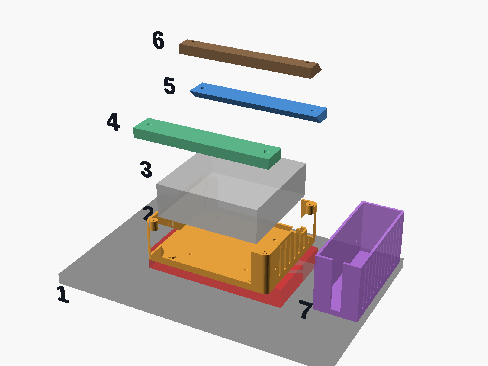
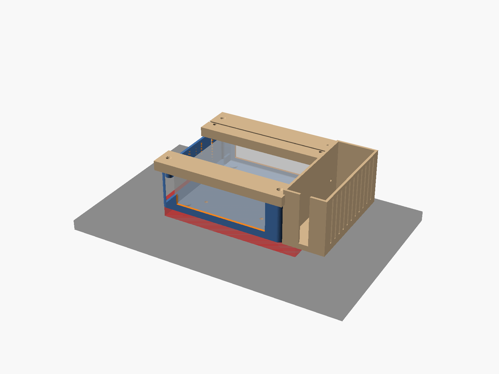

# FamilyHub — hardware & 3D-printed mount

Everything you need to turn a mini PC + a 15.6" touchscreen into the wall
display. The print files are parametric OpenSCAD (`familyhub-mount.scad`) so they
fit *your* exact monitor.

## Shopping list — current build (two matching C3 mini PCs, Pi 5 sold)

> **2026 price note:** both Raspberry Pis *and* mini PCs spiked (global RAM/SSD
> shortage). A new 16GB/512GB N100 is ~$340–400 now, and a Pi 5 8GB resells for
> ~$100–150. So the build is **two cheap i3 mini PCs** — one drives the screen, one is
> the headless Home Assistant box — funded partly by selling the Pi 5.

| Part | ~Cost | Amazon listing | Notes |
|---|---|---|---|
| **Forzola 15.6" FHD Touchscreen Monitor Industrial (HDMI/VGA/DVI, with remote)** | $140 | `15.6 inch touchscreen monitor industrial HDMI VESA` | **Chosen.** 10-pt capacitive, 300 nit IPS, **VESA 75×75**, 365×223×10 mm (23 mm at the port hump, 170 mm port strip along the bottom). In the box: HDMI cable, USB-B touch cable, 12V brick, remote. Dual speakers + audio out. |
| **C3 Mini PC, Intel i3-5005U, 8GB / 512GB** (origimagic) — **×2** | $170 each | `C3 Mini PC i3-5005U 8G 512G` | 2× HDMI, 4× USB-A + USB-C, Gigabit LAN, Wi-Fi 5, BT 5.0, **Auto Power On + Wake-on-LAN**, Linux-compatible, 15 W, 128×127×43 mm. #1 = FamilyHub kiosk + voice satellite behind the screen. #2 = Home Assistant OS, headless. |
| **USB speakerphone** (kitchen mic+speaker) | $35 | `USB speakerphone conference mic` (Anker PowerConf / eMeet) | Mic + speaker in one, for the wall voice / openWakeWord. |
| **Zooz ZST39 Z-Wave USB stick** (for the HA C3) | ~$30 | `Zooz 800 series Z-Wave stick` | Moves the smart plugs off the IQ Panel into Home Assistant. |
| M4 screws + wall anchors | ~$6 | `M4 screw assortment wall anchors` | For the VESA bolts / cleat. The mount itself is 3D-printed (below). |

**≈ $520 total**, minus the Pi 5 sale (~$100–150) → **≈ $370–420 net.** No HDMI cable or
VESA bracket to buy — the monitor ships with cables and the mount is printed.

> Skip the thin "portable" touch monitors (CAPERAVE / UPERFECT / InnoView / cocopar):
> they work electrically but have no VESA holes and power over USB-C. The industrial
> kiosk panel bolts straight to the printed case.

### Home Assistant "brain" (smart home / alarm / TVs)
Runs **separately** from the screen so a FamilyHub reboot/update can never take the house
(or alarm) down. Nothing about it "pairs" with the screen — FamilyHub only ever talks to it
over the LAN via `HA_URL`, so the HA box could be anything.
- **Chosen: the second C3 mini PC.** Boot the HAOS installer from a USB stick, install to
  its SSD, done. Headless in a cupboard — plug in **Ethernet** (it's the alarm bridge; don't
  rely on Wi-Fi) and power, enable **Auto Power On** in BIOS so it recovers from outages.
- Faster than a Pi 5 for HA, ~10–15 W. Matching hardware with the screen box means one
  spare-parts story.
- Alternatives if you'd rather not buy a second box: keep the Pi 5 (~5–8 W, HAOS on SD/NVMe)
  or a **Home Assistant Green** (~$99). Running HA *on the screen box* is possible but a
  reboot/update then drops the alarm too — not worth it.

### Voice — the touchscreen has NO mic or (usually) speaker
The 15.6" touchscreen is display + touch only. Pick the level of voice you want:

**A) Tap-to-talk on the wall** (built into FamilyHub — tap the mic, speak, it acts + replies aloud).
Needs a **mic + speaker on the screen C3**. Cleanest: one USB speakerphone on the counter.
- **USB speakerphone** (`USB speakerphone conference mic`, ~$30–45, e.g. Anker PowerConf / eMeet) — mic **and** speaker in one, great kitchen pickup. **Best pick.**
- Budget: a **USB mini microphone** (~$12) + the monitor's own speakers if it has them (check the listing; many 15.6" panels include small speakers + a 3.5 mm jack). Add cheap **USB speakers** (~$12) if not.

**B) Hands-free "Hey …" wake word — CHOSEN: openWakeWord (DIY, no extra hardware).**
Runs entirely on our own boxes, private (no Google/Amazon cloud):
1. On the HA C3, enable the **openWakeWord** add-on (it does the "Hey <Name>" wake-word detection — any name, see the HA guide).
2. On the kitchen (screen) C3, run a **Wyoming satellite** that streams the **USB speakerphone's**
   mic to HA and plays replies back on its speaker.
So the only hardware is the **USB speakerphone we already listed** — the wake word is all
software. (Optional later: add an **ESP32-S3 Wyoming satellite** ~$10–15, or the
plug-and-play *Home Assistant Voice PE* ~$60, to add voice in other rooms.)

**Phone voice:** the **Home Assistant companion app** has built-in Assist voice that works
on iPhone/Android from anywhere — so "turn on the kitchen lights" works from your phone too.
(FamilyHub's *web-app* mic works on Android/desktop Chrome, but iOS Safari doesn't support
the browser speech API, so use the HA app for phone voice on an iPhone.)

> **Alarm needs no new hardware** — the Qolsys IQ Panel's built-in 3rd-party
> automation (enabled with your dealer code) talks to HA over the LAN via `qolsysgw`.

**Rough total for the wall unit: ~$350** once (screen + one C3 + speakerphone + screws).
vs Skylight ~$300 up front **plus ~$40–80/yr forever**.

## Touchscreen alternatives (if the Forzola is out of stock)

Buy **capacitive multi-touch** with **VESA 75×75 holes** and a separate **USB-touch cable**
(USB-A end for the C3). Confirm the listing says **driver-free / plug-and-play**; avoid
"Windows driver required." Any "industrial / kiosk / POS" 15.6" HDMI touch panel with a
VESA badge is the same form factor as the Forzola.

> Prices/models drift and I can't see live listings from here — verify current
> availability and that the box includes the USB touch cable + HDMI cable.

## How it goes together



1. **Screen** (grey) with its raised rear housing (red) — the VESA holes are on that housing's face.
2. **back_case** (orange) bolts to the VESA holes with 4× M4; corner brackets inside cradle the mini PC. The two
   walls with the low opening pass the plugs; the two vented walls line up with the C3's fan faces.
3. **C3 mini PC** drops into the brackets, HDMI/LAN/power face toward the bottom opening, USB face toward the top one.
4. **foot_bar** (green) screws to the two **bottom** bosses with M3×16 — same thickness as the cleat so the display hangs plumb; also keeps the PC in.
5. **cleat_case** (blue) screws to the two **top** bosses with M3×16 — the hanging half of the French cleat (bevel on its bottom edge).
6. **cleat_wall** (brown) screws to the wall, bevel on its top edge sloping down toward the wall; the display hooks over it and lifts straight off.
   Its centre goes 20 mm below where the case cleat's centre will hang.
7. **spk_pocket** (purple, optional) bolts to the case side wall with 2× M3 and holds the speaker/mic bar, grille facing out.

Spin the whole thing around in the browser: open `hardware/mount-viewer.html` (self-contained; needs internet for three.js). Rebuild it from the `part="asm:<name>"` exports if you change the model.

Assembled (from the back, before it goes on the wall):



Re-render these from the model: `openscad -o hardware/exploded.png -D 'part="exploded"' --camera=20,-10,100,62,0,28,1050 --imgsize=1800,1350 hardware/familyhub-mount.scad`

## Ready-to-print files → `hardware/stl/`

Every part is pre-exported as an STL from the measured parameters, so you don't need
OpenSCAD unless you change a dimension. Drop them straight into your slicer (Anycubic
Slicer / Cura / PrusaSlicer).

**Print order:**
1. `test_vesa.stl` + `test_pc.stl` (~40 min total, 0.2 mm, 15% infill). Check that M4 screws
   thread into the monitor's VESA holes through the coupon, and the C3 drops into the cradle
   coupon with a little play. If either is off, change `vesa` / `pc_clear` in the `.scad`
   and re-export (see below) — don't print the case until these fit.
2. `back_case.stl` — the big one (~7 h). Print **cavity up** (as exported), 0.2 mm, 3 walls,
   20% infill, no supports.
3. `foot_bar.stl`, `cleat_case.stl`, `cleat_wall.stl` — flat, fast. Print the cleats bevel-up as exported (no supports).
4. `stand.stl` — optional counter easel (199 mm wide, 166 mm tall, base on the bed, no supports).
5. `spk_pocket.stl` — optional, only if you want the speaker bar hidden in the case.
6. **Picture frame** (optional, hides the whole black bezel): `frame_corner_top.stl` ×2 and
   `frame_corner_bottom.stl` ×2 (mirror one of each in the slicer for the right-hand corners),
   `frame_top.stl`, `frame_bottom.stl`, `frame_side.stl` ×2. Print **face down**, no supports.
   **Before printing, measure the screen's outer width and height** and set `panel_w` / `panel_h`
   in the `.scad` (the frame wraps the panel edge, so these two numbers decide the fit), then re-export.

Re-export after editing the `.scad`:
```bash
openscad -o hardware/stl/back_case.stl -D 'part="back_case"' hardware/familyhub-mount.scad
```

## The printed parts (tuned for the Forzola 15.6" + C3 mini PC + speaker bar)

Clean, Skylight-style install: the **mini PC and all cabling hide in a back case** that bolts to
the screen's **VESA 75×75** holes, and the whole display **lifts off a French cleat** onto a
counter stand — no tools. Print everything in one colour; only the glass shows from the
front. Open `familyhub-mount.scad` in OpenSCAD (free) and set `part`.

| Part | Qty | What it is |
|---|---|---|
| `back_case` | 1 | ~158×136×52 mm box that bolts to the VESA holes on the screen's back housing. Four corner brackets cradle the **C3** (HDMI/LAN/DC face down into the bottom slot; the other port face reachable through a top slot); open at the back for airflow; side vents at the C3's fan intakes. |
| `foot_bar` | 1 | 166×30×12 bar on the two **bottom** bosses (M3×16). Same thickness as the cleat so the display hangs plumb; also keeps the C3 from tipping out. (Replaces the old 4 mm `strap_bar`.) |
| `cleat_case` | 1 | 166×30×12 French-cleat half on the two **top** bosses (M3×16); 45° bevel on its bottom edge, wedge tip against the wall. |
| `cleat_wall` | 1 | 166×30×12 French-cleat half that screws to the wall; bevel on its top edge sloping down toward the wall. |
| `stand` | 1 | Counter easel: 12° leaning plate with a `cleat_wall` tongue at the matching height and a front lip, so the display drops from wall → stand in seconds. |
| `spk_pocket` | 0–1 | **Optional** pocket for the USB speaker/mic bar, bolted to the case's side wall (M3 + nuts). The bar stands vertically, grille + mic facing out the screen's side edge — hidden from the front. |
| `frame_*` | 8 | **Optional** picture frame: covers the black bezel (measured ~10 mm sides, 12 top, 24 bottom) so only the lit 344×194 picture shows. 28 mm flat face, 2 mm over the glass, wraps the edge and hooks behind the panel. 4 L-shaped corners (110×110) + 4 straights (231 / 81 long) that slide fully into the corner sleeves; all fit a 250 mm bed. |
| `test_vesa` / `test_pc` | 1 ea | Small coupons — **print these first**. |
| `preview` | — | Everything assembled over a ghost of the screen; the console **echoes the port-hump clearance**. |

> **Bed-size reality (Anycubic Kobra S1 ≈ 250mm):** the back case, cleats, and stand all
> fit. A one-piece 365mm front frame does **not** — that's why the frame is segmented, and
> why the clean look is built around the *back case* (the front just uses the monitor's own
> slim bezel unless you want the framed look).

### Step 0 — measure three things when the parts arrive
Set these at the top of the `.scad` before printing anything:
- Measured 2026-11: body 356×229 mm; a centred raised housing 178×102 mm, 28 mm proud,
  carries the VESA holes on its face and the ports on its bottom edge. The case bolts to
  that face and overhangs it 17 mm top/bottom; cables run in the 28 mm gap underneath.
- **`vesa_dy`** — only if the VESA square turns out off-centre on the housing.
- Speaker bar measured 127×64×44 mm (5 × 2.5 × 1.75 in) — already set.

### Step 1 — print the test coupons first (~40 min)
Render `test_vesa` and `test_pc`, print both, and check: M4 screws thread into the monitor's
VESA holes, and the C3 drops into the four corner brackets with ~1.5 mm of play. Tweak
`vesa` / `pc_clear` if anything's off before the big print.

### Step 2 — print the case + mounts
- `back_case`: **front-plate-down (cavity up)**, 0.2mm, 3 perimeters, 20% infill, no supports (~7h).
- `strap_bar`, `cleat_case`, `cleat_wall`, `stand`, `spk_pocket`: flat; the 45° cleat bevels self-support.
- Vents are on by default (`vent = true`).

### Step 3 — assemble & mount
1. Bolt `back_case` to the screen's **VESA 75** holes (M4). Cable slot at the bottom.
2. Drop the C3 in, **LAN/HDMI/DC face down** toward the slot. Plug in HDMI, the USB touch
   cable, the speaker's USB, Ethernet (if run), and the C3's DC lead. Everything exits the
   bottom slot alongside the monitor's own cables.
3. `strap_bar` across the top bosses, `cleat_case` across the bottom bosses (M3). The C3
   is now captive.
4. Optional: bolt `spk_pocket` to the side wall, slide the speaker bar in, cable through
   its notch to the C3.
5. **Wall:** screw `cleat_wall` to studs/anchors (use a level) → hang the display on it.
   **Counter:** drop the display's `cleat_case` onto the `stand` tongue.

### Step 4 (optional) — the framed look
Print `frame_seg` ×2 long + ×2 short, pin/glue at the corners, and set it over the front.
Tune `frame_face` (border width) and `frame_lip` (overlap — keep ≤ the screen's real black border).

## Wiring
C3 **HDMI → HDMI** into the monitor (cable in the monitor box) · monitor's **USB-B touch
cable → a C3 USB-A port** · **USB speakerphone → C3 USB-A** · monitor's **12V DC brick** (its
own power) · C3's own **DC brick**. Ethernet to the C3 if you can run one. All cables tuck
through the back-case bottom slot. Wall app boots full-screen via `kiosk.sh`.

The HA C3 lives elsewhere (cupboard/closet): **power + Ethernet only**, nothing else plugged in.
